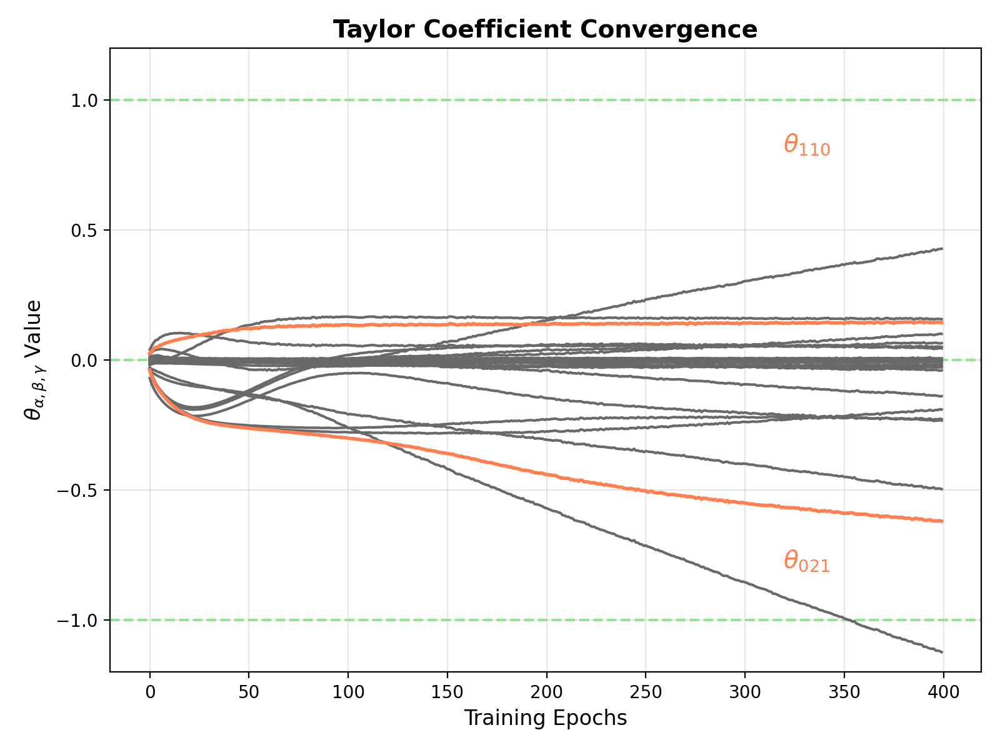

# Model-Based Inference of Synaptic Plasticity Rules

A PyTorch reproduction and extension of **"Model-Based Inference of Synaptic Plasticity Rules"**
(Mehta et al., NeurIPS 2024), with vectorised `einsum` simulation and support for real
*Drosophila melanogaster* behavioural data.

The method parameterises a synaptic plasticity rule as either a truncated Taylor series
(81 coefficients) or a small MLP, then optimises those parameters with backpropagation-through-time
so that the simulated circuit reproduces observed neural activity or behaviour.



## What is implemented

Three experiments of increasing difficulty:

1. **Oja's rule recovery** — recover a known plasticity rule from simulated neural trajectories.
2. **Behavioural plasticity** — infer a reward-based covariance rule from binary accept/reject choices.
3. **Fruit fly** — apply the method to real behavioural data from 18 flies
   ([Rajagopalan et al., 2023](https://doi.org/10.5281/zenodo.7449214)).

The appendix analyses are reproduced as well: hyperparameter sensitivity (L1, moving-average
window, mean input firing rate), scalability across trajectory lengths and network sizes,
generalisation across 46 plasticity rules, and held-out validation on fly data.

## Project structure

```
synaptic-plasticity-inference/
├── src/
│   ├── __init__.py
│   ├── network.py              # forward simulation (vectorised einsum)
│   └── plasticity_rules.py     # Taylor, MLP and fly rule parameterisations
├── circuit_model.py            # circuit model used by the Oja experiment
├── data_generation.py          # synthetic trajectory generation for Oja's rule
├── run_ojas_recovery.py        # Experiment 1 + Figure 2
├── run_behavior.py             # Experiment 2 (behavioural plasticity)
├── run_fly.py                  # Experiment 3 (real fly data)
├── run_fig4b.py                # Figure 4B: fly behaviour rasters
├── run_fig5_6_7.py             # Figures 5-7: hyperparameter sweeps
├── run_fig8_9.py               # Figures 8-9: held-out validation
├── run_table2.py               # Table 2: scalability analysis
├── run_tables1_3.py            # Tables 1 & 3: 46-rule comparison
├── process_fly_data.py         # raw Zenodo export -> .mat
├── process_fly_data_v2.py      # same, with variable-length trial support
├── run_all_collab.ipynb        # Colab notebook that runs the whole pipeline
├── data/                       # Fly1.mat ... Fly18.mat
├── figures/                    # generated figures
├── requirements.txt
└── LICENSE
```

## Installation

```bash
git clone https://github.com/<your-username>/synaptic-plasticity-inference.git
cd synaptic-plasticity-inference
python -m venv .venv
source .venv/bin/activate      # Windows: .venv\Scripts\activate
pip install -r requirements.txt
```

Requires Python 3.10+ and PyTorch 2.0+. CUDA is detected automatically and used when available.

## Usage

```bash
mkdir -p figures results
python run_ojas_recovery.py    # Experiment 1
python run_behavior.py         # Experiment 2
python run_fly.py              # Experiment 3
```

Appendix figures and tables:

```bash
python run_fig4b.py
python run_fig5_6_7.py
python run_table2.py
python run_fig8_9.py
python run_tables1_3.py
```

## Fly data

`data/` contains the 18 `Fly*.mat` files converted from the public Zenodo release
([DOI: 10.5281/zenodo.7449214](https://doi.org/10.5281/zenodo.7449214)). To rebuild them from the
raw export, run `process_fly_data.py` (or `process_fly_data_v2.py`).

## Implementation notes

Several details that the paper does not spell out turned out to be critical for reproducing the
results:

- Hidden-layer activation: `tanh` (not sigmoid as implied by Equation 1).
- Output layer: fixed weights of `5.0 / n_hidden`, not plastic.
- Plasticity learning rate: `1 / n_input` applied to weight updates.
- Input noise variance: `0.015` (not `0.05`).
- Taylor coefficient initialisation: scale `1e-5`.
- MLP rule: leaky-ReLU hidden layer, `tanh` output, all parameters initialised at scale `0.01`.
- Expected reward initialised to `0` (not `0.5`).

## Authors

This was a joint course project by:

- **Irmak Erkol**
- **Umut Alperen Cengiz**
- **Ertugrul Taparci**

Original shared repository: [irmakerkol/Model-Based-Inference-of-Synaptic-Plasticity-Rules](https://github.com/irmakerkol/Model-Based-Inference-of-Synaptic-Plasticity-Rules).

## Citation

If you use this code, please cite the original paper:

```bibtex
@inproceedings{mehta2024model,
  title     = {Model-Based Inference of Synaptic Plasticity Rules},
  author    = {Mehta, Yash and Tyulmankov, Danil and Rajagopalan, Adithya and Turner, Glenn
               and Fitzgerald, James and Funke, Jan},
  booktitle = {Advances in Neural Information Processing Systems (NeurIPS)},
  year      = {2024}
}
```

## License

MIT — see [LICENSE](LICENSE). This is an academic reproduction for educational purposes; the
original method and data belong to their respective authors.
